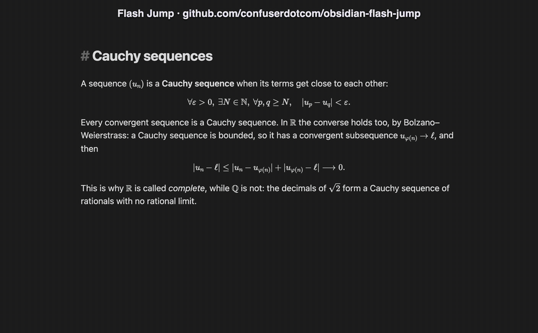

<p align="center">
  <b>flash.nvim for Obsidian.</b><br>
  Press <code>s</code>, type two letters, hit the label. Even inside rendered LaTeX maths.
</p>

<p align="center">
  <a href="https://github.com/confuserdotcom/obsidian-flash-jump/releases/latest"></a>
  <a href="https://github.com/confuserdotcom/obsidian-flash-jump/releases"></a>
  <a href="https://github.com/confuserdotcom/obsidian-flash-jump/actions/workflows/test.yml"></a>
  <a href="https://github.com/confuserdotcom/obsidian-flash-jump/stargazers"></a>
  <a href="LICENSE"></a>
</p>

<p align="center">
  <a href="#use">Use</a> ·
  <a href="#inside-maths">Inside maths</a> ·
  <a href="#settings">Settings</a> ·
  <a href="#install">Install</a>
</p>

Jump anywhere on screen in [Obsidian](https://obsidian.md)'s Vim mode, like [flash.nvim](https://github.com/folke/flash.nvim): press `s`, type a few characters of where you want to go, then the label that appears there.

What it adds over other jump plugins: **it reaches inside rendered LaTeX maths.** While a jump is open, the note shows its formulas as written, so `\varphi` in the middle of a `$$…$$` block is a target like any word; Live Preview comes back as soon as you land.

<details open>
<summary><b>See it in a real vault</b> (recorded in Obsidian)</summary>
<br>
<p align="center"></p>
</details>

## Use

| Keys | What they do |
| --- | --- |
| `s` then characters | labels appear on every match on screen, the closest first |
| the label | jump there |
| more characters | fewer matches; when one is left, it jumps by itself |
| `Enter` | jump to the closest match |
| `Backspace` | one character less |
| `Esc` | cancel |

- **Smart case**: lower case finds both cases, a capital makes the search exact.
- **Labels never get in the way of typing**: a letter that could continue what you typed is never a label, so typing on always narrows the search.
- **Visual mode**: `v` … `s` grows the selection to the target (the target character included).
- **Lands like `zz`**: the target line comes to the middle of the screen.
- Any other key (arrows, `Tab`, `Ctrl-…`), a click, switching notes or 20 s without a key end the jump; the key still does its normal job.
- `\`, `{`, `^` and accented letters are ordinary characters: on AZERTY, `AltGr` keys and dead keys work.

### Inside maths

When rendered maths is on screen, `s` switches the note to Source mode for the jump, with the cursor's line kept at the same height, and back to Live Preview when it ends (whatever ends it). A tab left in Source mode by a crash in the middle of a jump is put back the next time the plugin loads. Turn this off in the settings for plain jumps only.

If you use [Latex Suite](https://github.com/artisticat1/obsidian-latex-suite)'s conceal, Source mode still conceals: turn conceal off to see the raw LaTeX during a jump.

## Settings

- **Key**: the Vim key that starts a jump (default `s`; it replaces Vim's substitute, which is also `cl`). Changing it, or turning the plugin off, gives the old key back to Vim.
- **Label characters**: the letters used as labels, easiest first.
- **Jump inside rendered maths**: the Source-mode switch above.
- **Dim the note** during a jump.
- **Give up after**: seconds without a key before a jump ends by itself.

The command **Flash Jump: Jump** works without Vim too: bind it to a hotkey.

Labels and matches can be restyled in a CSS snippet:

```css
body { --flash-jump-label-bg: #7c5cff; --flash-jump-label-fg: #fff; --flash-jump-match-bg: rgba(124, 92, 255, .25); }
```

## Vim

Works with Obsidian's built-in Vim (**Settings → Editor → Vim key bindings**) and with [Vim Motions](https://github.com/saberzero1/obsidian-vim-motions) (re-registered after each of its config reloads). If Vim Motions' own flash jump (also on `s`) is on, turn it off in its settings.

The key is a Vim action, not a vimrc map: a `vnoremap s :…` would leave visual mode first and lose the selection, so don't map it in your vimrc.

## Install

Until it is in the community plugins list, either:

- use [BRAT](https://github.com/TfTHacker/obsidian42-brat): add `confuserdotcom/obsidian-flash-jump`, or
- download `main.js`, `manifest.json` and `styles.css` from the [latest release](https://github.com/confuserdotcom/obsidian-flash-jump/releases/latest) into `<vault>/.obsidian/plugins/flash-jump/`, then enable **Flash Jump** in Settings → Community plugins.

## Development

No build step: `main.js` is the plugin.

```sh
npm test               # unit tests: matching, labels, selection, keys, settings
node e2e-isolated.mjs  # real key presses in a separate Obsidian with a throwaway vault (macOS)
```

## Support

The plugin is free and stays free. If it saves you time, you can [support it here](https://confuserdotcom.lemonsqueezy.com).

## License

[MIT](LICENSE)

---

<p align="center">
  If it saves you a trip to the mouse, <a href="https://github.com/confuserdotcom/obsidian-flash-jump">a ⭐ on GitHub</a> helps other Obsidian users find it.<br>
  Bugs and ideas: <a href="https://github.com/confuserdotcom/obsidian-flash-jump/issues">open an issue</a>.
</p>

<a href="https://star-history.com/#confuserdotcom/obsidian-flash-jump&Date">
  <picture>
    <source media="(prefers-color-scheme: dark)" srcset="https://api.star-history.com/svg?repos=confuserdotcom/obsidian-flash-jump&type=Date&theme=dark">
    
  </picture>
</a>
